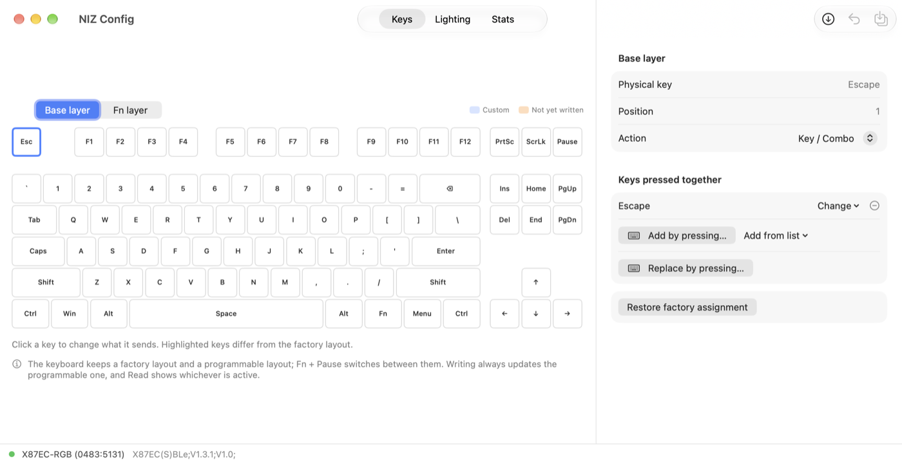
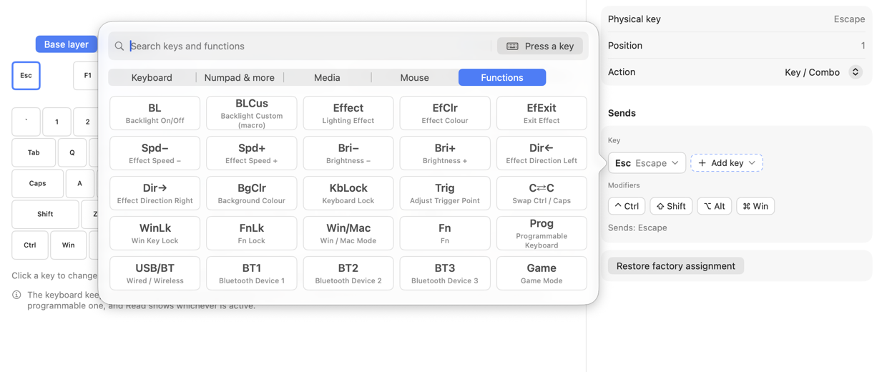
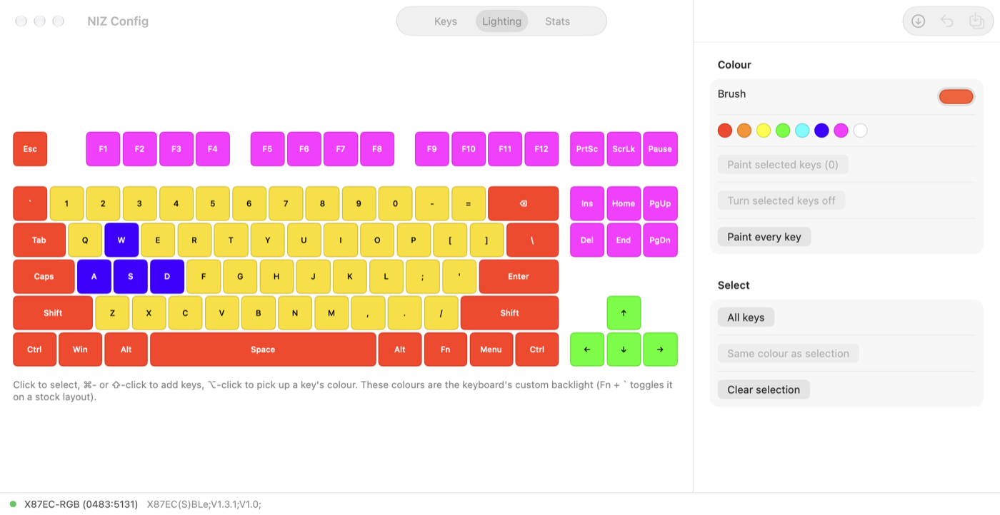

# NIZ X87EC Config for macOS

[简体中文](README.zh-CN.md)

A native macOS configuration tool for NIZ X87EC electro-capacitive keyboards,
replacing the vendor's Windows-only `X87EC.exe`. The protocol was reverse-engineered
from the Windows tool and verified on real hardware.



## Features

- **Key remapping** for the base layer and the Fn layer:
  - single keys and chords (modifier toggles + key, e.g. Ctrl + C)
  - repeat while held ("emulate") with a configurable interval
  - macros: play N times, play while held, or press to start/stop, with fixed or per-step delays
  - media keys, mouse keys and keyboard functions (backlight, BT 1–5, Win/Mac, Fn lock, game mode…)
- **Visual key picker**: click the key on a keyboard, browse categories, search by name, or just press it.
- **Per-key RGB backlight**: paint keys, select by colour, eyedropper (⌥-click).
- **Keystroke stats**: heatmap of the keyboard's lifetime per-key counters.
- **Profiles**: save and load JSON; `nizctl` CLI for backup and restore.
- Warns before writing a layout that would lock you out of Fn or the factory layout.

| Key picker | Lighting |
|---|---|
|  |  |

## Supported hardware

Tested on an **X87EC(S)BLe** (USB name `X87EC-RGB`, firmware `V1.3.1`).
Other X87EC variants the Windows tool accepts (USB `0483:5031`, `5131`, `5231`, `5331`)
should work, but are untested. USB only; Bluetooth is not supported.

## Build

Requires macOS 14+ and Xcode 15+ (Swift 5.10).

```sh
git clone https://github.com/krhougs/niz-87ec-config-mac.git
cd niz-87ec-config-mac
./build-app.sh          # -> dist/NIZ Config.app and dist/nizctl
swift test              # protocol tests against captured device traffic
```

The app is ad-hoc signed. On first launch, right-click it and choose Open, or run
`xattr -dr com.apple.quarantine "dist/NIZ Config.app"`.

## Usage

### 1. Switch the keyboard to Win mode

In **Mac mode** the keyboard identifies as an Apple keyboard and **hides its configuration
interface**, so nothing can talk to it.

1. Hold **Fn** and press **Left Alt** (third key from the left on the bottom row).
2. **Unplug and replug** the USB cable. The mode only changes on re-enumeration.

The app shows these steps when it detects the keyboard in Mac mode, and connects
automatically once it's in Win mode. Do the same again to go back to Mac mode afterwards.

### 2. Edit and write

Open **NIZ Config**. It reads keys, lighting and counters on connect. Make changes, then
press **Write Keys** or **Write Lighting** in the toolbar. Unwritten keys are tinted orange.

### Factory layout vs programmable layout

The keyboard stores **two layouts**, and **Fn + Pause** switches between them:

- **Factory layout**: fixed.
- **Programmable layout**: what this tool (and the Windows tool) writes to.

Writing always goes to the programmable layout, and **Read** shows whichever layout is
active. If the keyboard is on its factory layout when you write, the app tells you so;
press **Fn + Pause** to use your changes.

## CLI

```sh
dist/nizctl info                 # model and firmware version
dist/nizctl keys [layer]         # dump the key table
dist/nizctl lights               # per-key colours
dist/nizctl counters             # keystroke counters, most-used first
dist/nizctl backup my.json       # save keymap + lighting
dist/nizctl restore my.json      # write keymap + lighting
dist/nizctl restore-keys my.json
dist/nizctl restore-lights my.json
```

Back up before experimenting: `dist/nizctl backup original.json`.

## Notes and limitations

- The firmware stores 6 layers per layout. Layers 3–6 are copies of base/Fn on a stock
  keyboard (probably used by other connection modes; not confirmed). **Any layer not sent
  in a write is cleared.** The Windows tool sends only 2, so this tool sends all 6 and mirrors
  base/Fn into 3–6.
- Macros and repeat keys follow the Windows tool's encoding and pass round-trip tests, but
  have had less real-world testing than plain remaps.
- Firmware update is intentionally not implemented.
- A few function code names (e.g. `0xB0`–`0xB2`) come from the Windows tool's tables and may
  be mislabelled for some models.

## Protocol

See [PROTOCOL.md](PROTOCOL.md) for USB identifiers, commands, record formats, key positions
and key codes.

## Project layout

```
Sources/NIZKit     HID transport, protocol codec, key codes, layout (no UI)
Sources/NIZConfig  SwiftUI app
Sources/nizctl     command-line tool
Tests/NIZKitTests  codec tests using packets captured from a real keyboard
```

## Disclaimer

Unofficial, not affiliated with NIZ. Writing to the keyboard is at your own risk; keep
a backup (`nizctl backup`).

## License

[MIT](LICENSE)
